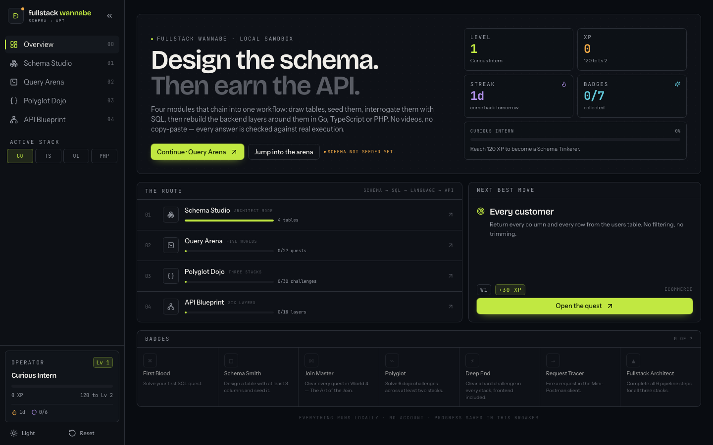
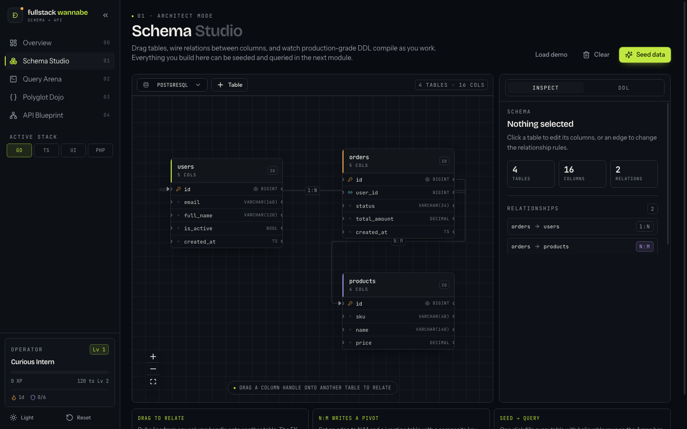
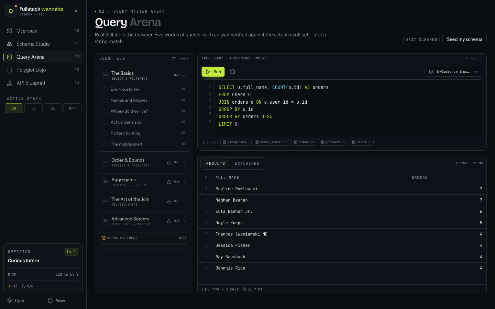
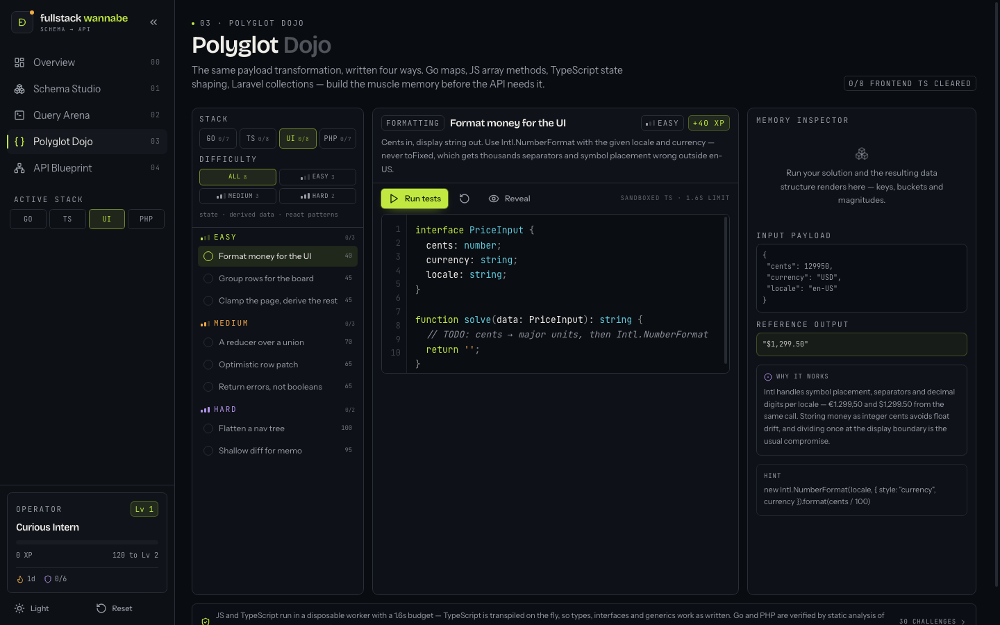
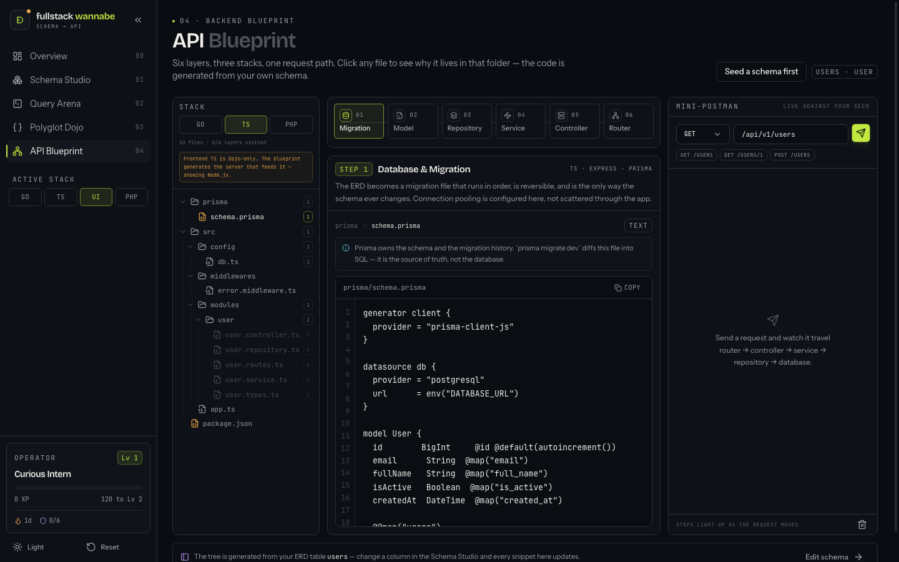

# fullstack-wannabe

**Design the schema. Then earn the API.**

A browser-only learning app that walks the full path from a drawn entity-relationship
diagram to a running SQL query, a polyglot implementation of the same transformation, and
schema-driven backend code — with every answer checked against real output rather than a
string match.

No backend, no build-time API keys, no network calls at runtime. SQLite runs through
WebAssembly, JavaScript and TypeScript execute in a killable Web Worker, and progress
lives in `localStorage`.



**Requirements:** Node 18 or newer.

```bash
npm install
npm run dev        # http://localhost:5173
```

---

## Contents

- [What's inside](#whats-inside)
  - [01 · Schema Studio](#01--schema-studio)
  - [02 · Query Arena](#02--query-arena)
  - [03 · Polyglot Dojo](#03--polyglot-dojo)
  - [04 · API Blueprint](#04--api-blueprint)
- [Progression](#progression)
- [Development](#development)
- [Deliberately out of scope](#deliberately-out-of-scope)
- [Tech](#tech)

---

## What's inside

Four modules, ordered so each one feeds the next:

| # | Module | Route | What you actually do |
|---|--------|-------|----------------------|
| 00 | **Overview** | `/` | Progress, badges, level, resume where you left off |
| 01 | **Schema Studio** | `/erd` | Draw tables and relations, watch the DDL compile, seed real rows |
| 02 | **Query Arena** | `/sql` | 27 quests across 5 worlds against live SQLite |
| 03 | **Polyglot Dojo** | `/dojo` | 30 challenges, easy → hard, in Go / Node / Frontend TS / PHP |
| 04 | **API Blueprint** | `/blueprint` | Six layers from migration to router, generated from your schema |

### 01 · Schema Studio

An interactive ERD canvas (`@xyflow/react`) with custom table nodes. Add tables and columns,
wire 1:1, 1:N and N:M relations, then choose a dialect — PostgreSQL, MySQL or SQLite — and
the DDL regenerates as you type. Copy it or download the `.sql`.

The Faker seeder writes realistic rows into the in-browser database, so the arena has
something to query. Junction tables are synthesised from real relation combinations and
sample distinct pairs, which matters because duplicate pairs collide on a composite key.

On mobile the canvas is full-screen with pinch/pan, and the inspector and DDL move into
bottom drawers.



### 02 · Query Arena

`sql.js` (SQLite compiled to WebAssembly) with three themed datasets:

- **E-Commerce Empire** — orders, revenue, retention
- **Social Network** — follows, posts, engagement
- **Guild RPG** — characters, raids, loot

27 quests across five worlds:

| World | Focus |
|-------|-------|
| 1 · The Basics | `SELECT`, aliases, `DISTINCT`, `WHERE`, `IN`, `BETWEEN`, `LIKE` |
| 2 · Order & Bounds | `ORDER BY`, `LIMIT`, `OFFSET` |
| 3 · Aggregates | `COUNT`, `SUM`, `AVG`, `MIN`, `MAX`, `GROUP BY`, `HAVING` |
| 4 · The Art of the Join | `INNER`, `LEFT`, multi-table joins |
| 5 · Advanced Sorcery | subqueries, CTEs, `CASE`, window functions |

Answers are validated by comparing the **actual result set** to the reference — order
insensitive and numeric tolerant — so a query that produces the right rows passes even if
it doesn't match the reference text.

The editor has syntax highlighting, line numbers, `⌘↵` to run, and autocomplete: keywords,
SQL functions, live tables and their columns. `↑`/`↓` to move, `Tab` or `Enter` to insert,
`Esc` to dismiss. Typing `orders.` narrows to that table's columns. It stays quiet inside
comments and strings.

Hover a table chip below the editor to see its columns with PK / FK / unique / not-null /
auto-increment markers.

**Your schema is a fourth dataset.** Seed the ERD and "My schema (ERD)" appears in the
dataset picker — the arena then queries the tables you drew instead of the fixtures, which is
what makes the studio-to-arena hop real rather than decorative.



### 03 · Polyglot Dojo

The same payload transformation, written four ways. Each challenge grades your code by
running it against a reference implementation and comparing the output.

| Stack | Challenges | Topics |
|-------|-----------|--------|
| Go | 7 | maps, slices, structs & pointers, channels, error wrapping |
| Node.js / TS | 8 | array methods, `Map`/`Set`, promises, object shaping |
| Frontend TS | 8 | derived state, pagination, reducers, optimistic updates, forms, memo diffing |
| PHP 8 / Laravel | 7 | array functions, null safety, collections, enums, `match` |

Every challenge carries a difficulty — **easy**, **medium** or **hard** — and XP scales
with it (35 → 100). The list is grouped Easy → Medium → Hard with per-bucket counters, and
a filter row narrows it. Each stack covers all three difficulties, so there's always a
gentle entry and a real wall.

JavaScript and TypeScript run in a disposable Web Worker with a 1.6 s budget, so an
infinite loop gets terminated instead of freezing the page. **TypeScript actually
executes**: `sucrase` transpiles inside the worker, so `interface`, `type`, generics and
annotations work as written. Go and PHP are verified by static analysis of the required
constructs plus a reference output you can compare by eye.

The inspector panel shows the input payload, your returned value as a live data structure,
and a short "why it works" explanation.



### 04 · API Blueprint

Six layers, each mapped to a real folder tree generated from your ERD:

1. **Database & Migration** → 2. **Model / Entity** → 3. **Repository / DAL** →
4. **Service / Business Logic** → 5. **Controller / Handler** → 6. **Router & REST API**

Pick a step, read the code with the schema substituted in, then trace a request through
the pipeline. The Mini-Postman tester sends method, path and body against a seeded mock
with realistic latency and status codes.

The six layers are server-shaped, so this module generates **Go, Node.js and PHP**. The
Frontend TS track is Dojo-only; selecting it here resolves to Node.js and says so.



---

## Progression

XP from quests, challenges and blueprint steps drives ten levels, from *Curious Intern* to
*Wannabe No More*. Seven badges:

| Badge | How you earn it |
|-------|-----------------|
| First Blood | Solve your first SQL quest |
| Schema Smith | Design a table with ≥ 3 columns and seed it |
| Join Master | Clear every quest in World 4 |
| Polyglot | 6 dojo challenges across at least two stacks |
| Deep End | A **hard** challenge in every stack, frontend included |
| Request Tracer | Fire a request in Mini-Postman |
| Fullstack Architect | All 6 pipeline steps for all three backend stacks |

Progress, active stack, drafts and theme persist to `localStorage` under the `fsw:` prefix.
Dark by default, with a light-theme toggle in the sidebar and a `Reset` that clears
everything.

---

## Development

```bash
npm run dev          # dev server
npm run build        # tsc --noEmit && vite build
npm run typecheck    # types only
npm run preview      # serve the production build
npm run check:dojo   # challenge-bank integrity check
npm run smoke        # 15-check CDP smoke suite against a real build
```

### `npm run check:dojo`

Every challenge ships a reference solution, and the app grades by comparing against it —
so the reference has to actually run. This check:

- executes all 16 runnable reference solutions through the **same contract the worker uses**
  (sucrase transpile + `new Function`)
- grades all 14 static challenges through the **real `staticCheck()`**, not a reimplementation
- verifies every stack covers all three difficulties
- verifies no untouched starter already passes

Reimplementing the grading logic in the check once hid a real bug, which is why the check
imports the actual function.

### `npm run smoke`

Needs a production build and a preview server running:

```bash
npm run build
npx vite preview --port 4173 --host 127.0.0.1   # --host matters; localhost can resolve to ::1
npm run smoke
```

Drives headless Chrome over the DevTools Protocol — no test framework, no mocking. It
exercises the real paths: SQL executes in `sql.js`, the TypeScript challenge runs in the
app's own worker, and every reference solution is pasted in and graded. Override the browser
with `SMOKE_CHROME` or the target with `SMOKE_BASE`.

The 15 checks cover each module, then a responsive audit across 20 route × breakpoint
combinations and a console-error tripwire. Two details worth knowing if you extend it:
`innerText` applies `text-transform`, so assertions lowercase before matching; and setting a
React-controlled textarea needs the native value setter plus an `input` event.

Chrome needs `--no-sandbox --in-process-gpu --disable-dev-shm-usage` in containerised
environments or its network service crashes and the WebSocket opens without ever delivering a
frame.

### Layout

```
src/
├── components/
│   ├── ui/            shadcn-style primitives over Radix
│   ├── CodeEditor     Prism highlighting + transparent-textarea overlay
│   └── layout/        Sidebar, mobile chrome, logo
├── lib/
│   ├── progress.tsx   XP, levels, badges, active stack
│   ├── completions.ts caret measurement + menu positioning
│   ├── storage.ts     localStorage-backed state
│   └── nav.ts
└── modules/
    ├── erd/           canvas, inspector, DDL generator, Faker seeder
    ├── sql/           sql.js wrapper, datasets, quests, autocomplete vocab
    ├── dojo/          challenge bank, worker sandbox, state visualizer
    └── blueprint/     folder trees, pipeline, Mini-Postman
```

### Conventions

- **Design tokens are two-layered.** `--x-c` holds raw oklch channels and is consumed as
  `oklch(var(--x-c) / <alpha-value>)`; `--x` is the composed value. A plain `var(--x)`
  silently drops `/opacity` utilities in Tailwind — use the `-c` form whenever you need an
  alpha.
- **`sql.js` must be imported as `sql.js/dist/sql-wasm.js`.** Vite's `browser` export
  condition otherwise resolves to a build with no default export.
- **Never trust `document.activeElement`** to decide whether the user is typing — under
  Chrome emulation it can report `BODY` mid-input. Track focus with `onFocus`/`onBlur` and
  a ref.
- **`innerText` applies `text-transform`.** Lowercase it before asserting on rendered copy.
- Modules are lazy-loaded with `React.lazy`; keep that boundary.

### Verification

`tsc --noEmit` clean and `vite build` clean, then smoke-tested against the **production**
build over CDP — 15 functional checks, 0 console errors, 0 horizontal overflow across 20
route × breakpoint combinations (375 / 768 / 1024 / 1440).

---

## Deliberately out of scope

- **No E2E / Playwright suite** — the CDP smoke suite above plus offline challenge checks
  cover the same ground without the dependency weight.
- **No real Go/PHP runtime** — a browser-only app, so those stacks are statically analysed
  against required constructs.
- **No backend server or real database** — everything runs client-side by design.
- **The Dojo payload isn't live-linked to your query results** — it's a shared fixture shaped
  like the `orders` table, so the drill is reproducible.

## Tech

Vite 6 · React 18 · TypeScript (strict) · Tailwind 3 · Radix primitives · `@xyflow/react`
· `sql.js` · `@faker-js/faker` · Prism.js · Framer Motion · Lucide
